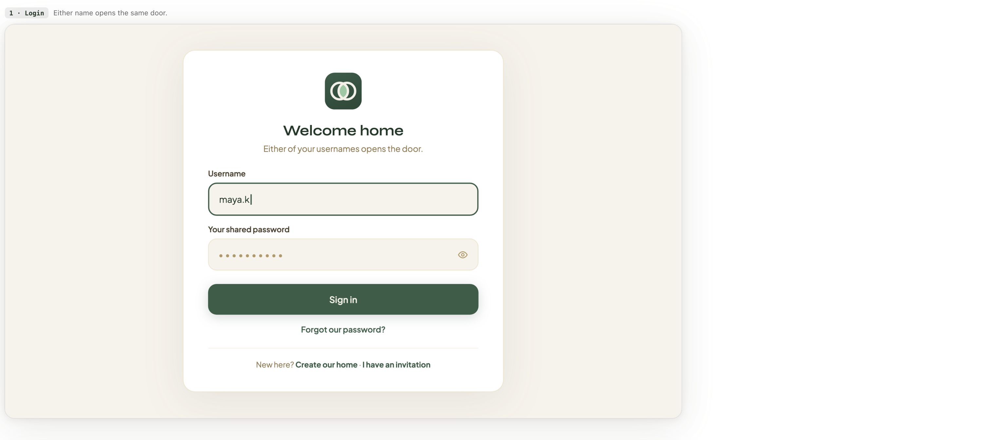
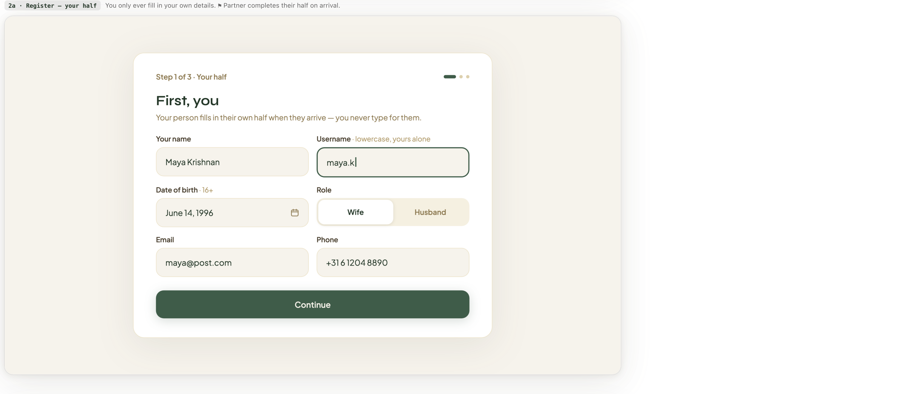
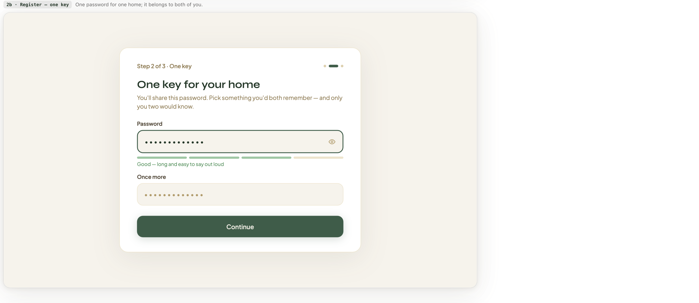
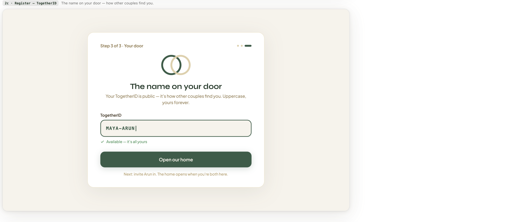

# Auth Design Reference — Login & Registration

Source: `Together - Hearth Desktop II.pdf`, "Auth · Light" section, screens 1 and 2a–2c.
These are the **authoritative visual and verbal references** for the login and signup
screens. Copy is part of the design: the wording below is normative, not illustrative.

The deck's own framing for this section:

> The front door and the locksmith. One shared key for the couple; every screen says
> what a click means for the other partner before the button, not after.
> **Nothing here scolds.**

Screens 3 (Forgot password) and 4 (Reset password) live in the same PDF section but are
**out of scope** for this reference; extract them separately when those flows are specced.

---

## 1 · Login — `01-login.png`

Caption in deck: *"Either name opens the same door."*

| Element | Value |
| --- | --- |
| Logo | Two overlapping circles, dark green rounded-square tile |
| Heading | **Welcome home** |
| Subheading | Either of your usernames opens the door. |
| Field 1 | `Username` — plain text, focused state shown (dark green 2px border) |
| Field 2 | `Your shared password` — masked, trailing eye toggle |
| Primary button | **Sign in** — full width, dark green, white text |
| Secondary link | Forgot our password? |
| Divider | Hairline rule |
| Footer | New here? **Create our home** · **I have an invitation** |

Notes:

- Single centered card on a cream field, no split hero, no illustration panel.
- Password label is "Your shared password" — the couple has one password, and the copy
  says so at the point of entry.
- The footer resolves the deck's "one centered decision" problem by offering the two
  *new-user* paths (create vs. invited) as inline links, not competing buttons.

---

## 2a · Register, Step 1 — `02a-register-step1-your-half.png`

Caption in deck: *"You only ever fill in your own details. ⚑ Partner completes their half on arrival."*

| Element | Value |
| --- | --- |
| Step label | Step 1 of 3 · Your half |
| Step indicator | Three dots, first one elongated/filled |
| Heading | **First, you** |
| Subheading | Your person fills in their own half when they arrive — you never type for them. |
| Field | `Your name` (text) |
| Field | `Username` · helper: *lowercase, yours alone* (focused state shown) |
| Field | `Date of birth` · helper: *16+* — with calendar picker affordance |
| Field | `Role` — segmented control, two options: **Wife** / **Husband** |
| Field | `Email` (text) |
| Field | `Phone` (text, international format shown: `+31 6 1204 8890`) |
| Primary button | **Continue** — full width, dark green |

Notes:

- Two-column field grid. Name/Username, DOB/Role, Email/Phone.
- **Only one partner's details are collected at signup.** This is the deck's answer to
  the thirteen-field problem raised in
  [`design-request-missing-screens.md`](../../design-request-missing-screens.md): the
  second partner completes their own half when they accept the invitation.
- The `⚑` flag in the caption marks a designer-raised concern, not a UI element.

---

## 2b · Register, Step 2 — `02b-register-step2-one-key.png`

Caption in deck: *"One password for one home; it belongs to both of you."*

| Element | Value |
| --- | --- |
| Step label | Step 2 of 3 · One key |
| Heading | **One key for your home** |
| Subheading | You'll share this password. Pick something you'd both remember — and only you two would know. |
| Field | `Password` — masked, eye toggle, focused |
| Strength meter | Four segments, three filled green, one unfilled |
| Strength text | Good — long and easy to say out loud |
| Field | `Once more` — masked confirm, no eye toggle |
| Primary button | **Continue** |

Notes:

- Strength copy is qualitative and warm ("easy to say out loud"), never a red
  "weak password" scold. The meter has no numeric score.
- Single-column layout, unlike step 1.

---

## 2c · Register, Step 3 — `02c-register-step3-togetherid.png`

Caption in deck: *"The name on your door — how other couples find you."*

| Element | Value |
| --- | --- |
| Step label | Step 3 of 3 · Your door |
| Logo | Two overlapping circles, outlined — green + sand, larger than login |
| Heading | **The name on your door** |
| Subheading | Your TogetherID is public — it's how other couples find you. Uppercase, yours forever. |
| Field | `TogetherID` — monospace, uppercase input (`MAYA-ARUN`) |
| Availability state | ✓ Available — it's all yours (green, check icon) |
| Primary button | **Open our home** |
| Footer note | Next: invite Arun in. The home opens when you're both here. |

Notes:

- TogetherID is checked for availability **live, inline**, below the field.
- "Uppercase, yours forever" states immutability at the point of choice.
- The footer note pre-announces the invitation step — the home is not considered open
  until the partner joins.
- The final CTA is **Open our home**, not "Create account" or "Sign up".

---

## Cross-cutting visual language

- **Field**: cream/sand background, no border at rest; dark green 2px border + soft
  shadow on focus.
- **Primary button**: dark green (`#3D5A45`-ish), full-width, generous radius, subtle
  drop shadow. One primary action per card, always.
- **Card**: white, large radius, floating on a cream inner panel inside a cream page.
- **Type**: geometric sans; headings in near-black green, body/helper text in a warm
  brown-gold.
- **Helper text** sits inline with the label (`Username · lowercase, yours alone`),
  not below the field.
- Tone: no red, no exclamation, no scolding. Consequences for the partner are stated
  before the button, never after.
