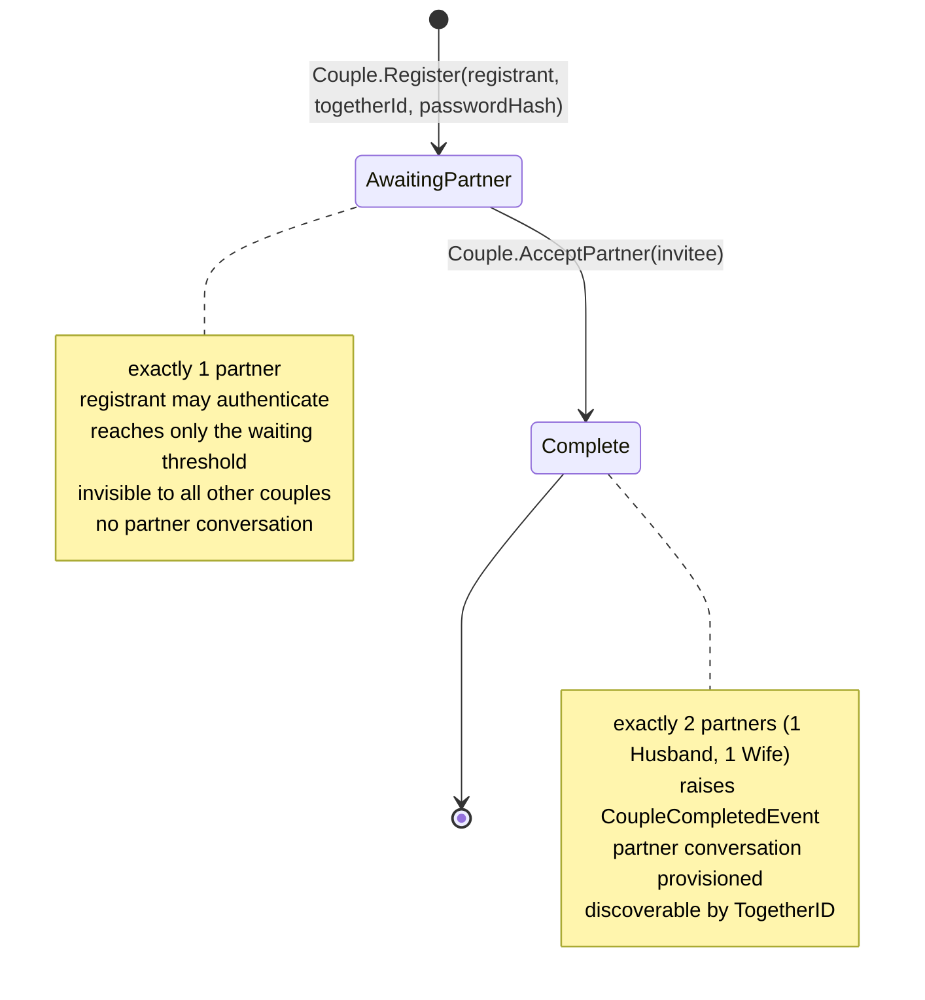

# TDD: Login & Registration — "Hearth" Redesign

**Feature:** Login & Registration ("Hearth" redesign)
**Slug:** `auth-login-registration`
**Design Tier:** Comprehensive
**Complexity:** Platform (modifies the authentication aggregate)
**Status:** `Ready for Implementation (with stated assumptions)`
**Date:** 2026-07-10

**Source spec:** [`features/auth-login-registration.spec`](./auth-login-registration.spec)
**Design references (normative copy):** [`docs/design/auth/`](../docs/design/auth/README.md)

---

## 1. Overview

### Scope & Tier Summary

This change re-cuts the `Couple` aggregate so a couple may exist with **one** partner. It touches **Domain** (new `CoupleState`, nullable `Husband`/`Wife`, new `Couple.Register`/`AcceptPartner`, new `CoupleInvitation` entity, three reshaped domain events), **Application** (two new commands, one new query, and repairs to **nine** existing handlers across Auth, Connect, Messaging, and Profile), **Infrastructure** (EF migration, state-filtered search, unique index on `(CoupleId, Role)`), **API** (replaced `POST /auth/register`, new availability and session endpoints, new rate-limit policy), and **Frontend** (`modules/auth` rebuilt as login + 3-step wizard, a new `CompleteCoupleRoute` guard, `auth.store` gains `coupleState`).

Tier is Comprehensive because the aggregate under change is transitively depended on by Connect, Messaging, and Profile, and because the login and token-refresh paths themselves fault under the new model.

### Goals

1. Registration collects only the registrant's own half; the invitee supplies their own.
2. A `Couple` can exist and authenticate with one partner without faulting any consumer.
3. Ship the four reference screens with normative copy intact.
4. Replace character-class password rules with a length-based passphrase policy.
5. Deliver in three chunks, each leaving the full test suite green.

### Non-Goals

- Invite and invitation-acceptance **screens** (Chunk 3; design pending — spec **A6**).
- Forgot/Reset password **screens**. The `ForgotPasswordCommandHandler` solo-couple defect fix **is** in scope.
- Dark theme; social sign-in; same-sex couple support (spec **A5**).
- Fixing `SearchCoupleQueryHandler`'s N+1 or its partial-match semantics (see §12, R-7).

### Key Assumptions

Carried from the spec (**A1**–**A8**) and confirmed with the requester on 2026-07-10:

- **D-1** `POST /auth/register` now issues tokens and sets the refresh cookie, exactly as login does.
- **D-2** Implementation proceeds backend-first; the invite API exists in Chunk 1 without UI.
- **D-3** Passwords are capped at **72 UTF-8 bytes** (BCrypt's silent truncation boundary).
- **D-4** Wizard state, including the plaintext password, lives **in memory only**. A refresh restarts the wizard.

---

## 2. Corrections to the Spec's Stated Blast Radius

The spec names five faulting consumers. Verified against the code, the fault surface is **`Couple.Husband` and `Couple.Wife` themselves** — `_partners.Single(...)`, which throws when a partner is absent — plus four aggregate methods built on them. The true list is **nine sites**, three of which the spec never names, two on critical paths.

| # | Site | Reached via | Consequence for an `AwaitingPartner` couple |
| --- | --- | --- | --- |
| 1 | `LoginCommandHandler:83` | `FindPartnerByUsername` | **Login throws.** Spec FR-8 is unimplementable as written. |
| 2 | `RefreshTokenCommandHandler:45` | `GetPartner` | Token refresh throws; registrant silently logged out. |
| 3 | `GetProfileQueryHandler:23-24` | `GetPartner`, `GetOtherPartner` | Registrant's **own** profile unreachable, not just the partner's. |
| 4 | `UpdateProfileCommandHandler:37` | `GetPartner` | Throws |
| 5 | `UploadProfilePictureCommandHandler:58` | `GetPartner` | Throws |
| 6 | `Couple.ChangePassword:107` | `Husband.Email`, `Wife.Email` | Throws when raising `PasswordChangedEvent` |
| 7 | `ProvisionPartnerConversationHandler:35` | direct | Throws on `CoupleRegisteredEvent` |
| 8 | `GetConversationsQueryHandler:73` | direct, in `EnsurePartnerConversationAsync` | Throws on **every conversation-list load** |
| 9 | `ForgotPasswordCommandHandler:74-82` | direct | Throws while composing reset emails |
| 10 | `SearchCoupleQueryHandler:42-45` | direct | Throws, or leaks a half-formed couple |
| 11 | `GetConnectionsQueryHandler:49-52` | direct | Throws |
| 12 | `CreateGroupConversationCommandHandler:44,62` | direct | Throws |
| 13 | `AddCoupleToConversationCommandHandler:51` | direct | Throws |

**The spec's stated safety net does not exist.** It claims `EnsurePartnerConversationAsync` "makes the transition non-breaking for couples that predate the change." At `GetConversationsQueryHandler:73` that method calls `Conversation.CreatePartner(coupleId, couple.Husband.Id, couple.Wife.Id)` — the exact throwing expression — and it runs on **every** `GET /conversations`, not only after registration. It is site #8, not a mitigation.

**Registration authenticates nobody.** `POST /auth/register` returns `201 CreatedAtAction` with `RegisterCoupleResult(CoupleId, TogetherID)`, sets no cookie, and `useRegister` navigates to `/login` with a toast. Spec FR-24's "routes to the invite screen" is unreachable. Resolved by **D-1**.

### Design consequence

Do **not** patch thirteen call sites. Change the aggregate so the **compiler** enumerates them:

```csharp
public Partner? Husband => _partners.SingleOrDefault(p => p.Role == PartnerRole.Husband);
public Partner? Wife    => _partners.SingleOrDefault(p => p.Role == PartnerRole.Wife);
```

Every one of the thirteen sites becomes a nullable-reference warning. With `<Nullable>enable</Nullable>` and `TreatWarningsAsErrors` on the Domain/Application projects, none can be missed. This is the single most important decision in this document (**DL-1**).

---

## 3. Functional Requirements

Traceable to the spec's FR numbers. `TDD-FR-*` are new requirements this design introduces.

| ID | Requirement | Spec ref |
| --- | --- | --- |
| FR-1…8 | Login screen structure, copy, either-username auth, uniform failure, awaiting-partner routing | FR-1–8 |
| FR-9…15 | Step 1: copy, six own-half fields, role control, username validation, DOB bounds | FR-9–15 |
| FR-16…19 | Step 2: copy, confirm match, ≥12 chars, qualitative meter, warn-not-block | FR-16–19 |
| FR-20…24 | Step 3: copy, uppercase TogetherID, live availability, atomic creation | FR-20–24 |
| FR-25…31 | Couple lifecycle, complementary role, awaiting-partner restrictions, provisioning on completion | FR-25–31 |
| **TDD-FR-1** | `POST /auth/register` shall return the login response shape and set the refresh cookie. | D-1 |
| **TDD-FR-2** | The system shall reject passwords exceeding 72 UTF-8 bytes. | D-3 |
| **TDD-FR-3** | `GET /auth/session` shall return the caller's current `coupleState` without a token refresh. | §7 |
| **TDD-FR-4** | A TogetherID claimed between availability check and submit shall yield `409 TOGETHER_ID_TAKEN`, not a 500. | Spec edge 3 |
| **TDD-FR-5** | The database shall enforce at most one partner per `(CoupleId, Role)`. | §5.3 |
| **TDD-FR-6** | `SearchByTogetherIDAsync` shall exclude couples not in state `Complete`. | FR-27b |

---

## 4. Couple Lifecycle



`Complete` is terminal. There is **no** transition back (spec FR-25). `IsActive` (deactivation) is an orthogonal flag and is unchanged by this work.

---

## 5. Domain Model

### 5.1 New enum

`Saha.Domain/Enums/CoupleState.cs`

```csharp
public enum CoupleState { AwaitingPartner = 0, Complete = 1 }
```

### 5.2 `Couple` — changed surface

`Saha.Domain/Entities/Couple.cs`

| Member | Before | After |
| --- | --- | --- |
| `State` | — | `CoupleState`, private setter |
| `IsComplete` | — | `=> State == CoupleState.Complete` |
| `Husband` / `Wife` | `Partner` (`Single`) | **`Partner?`** (`SingleOrDefault`) |
| `RequireHusband()` / `RequireWife()` | — | returns `Partner`, else `DomainException("COUPLE_INCOMPLETE")` |
| `Register(...)` | 11 partner params | `(togetherId, username, name, dob, email, phone, role, passwordHash)` |
| `AcceptPartner(...)` | — | `(username, name, dob, email, phone)` → `Complete` |
| `GetPartner(Guid)` | via `Husband`/`Wife` | `_partners.SingleOrDefault(p => p.Id == id)` ?? throw `PARTNER_NOT_FOUND` |
| `GetOtherPartner(Guid)` | via `Husband`/`Wife` | **`Partner?`** — `null` while `AwaitingPartner` |
| `FindPartnerByUsername(string)` | via `Husband`/`Wife` | iterate `_partners` |
| `ChangePassword(...)` | `PasswordChangedEvent(…, Husband.Email, Wife.Email)` | event carries `IReadOnlyList<string> Emails` from `_partners` |

**Invariants enforced in `AcceptPartner`:**

- `State == AwaitingPartner`, else `DomainException("COUPLE_ALREADY_COMPLETE")`.
- Invitee username ≠ registrant username, case-insensitive → `USERNAMES_MUST_DIFFER` (preserved).
- Invitee email ≠ registrant email, case-insensitive → `EMAILS_MUST_DIFFER` (preserved).
- Invitee role is the **complement** of the registrant's (spec **A1**), assigned by the aggregate — never supplied by the caller.
- Transition sets `State = Complete` and raises `CoupleCompletedEvent`.

`Register` no longer performs the `USERNAMES_MUST_DIFFER` / `EMAILS_MUST_DIFFER` checks — there is no second partner to compare against. They move wholesale to `AcceptPartner`.

> **Existing wart, left alone:** `Couple.Register` sets `CreatedAt`/`UpdatedAt` manually despite `AuditableEntityInterceptor`. Out of scope; do not "fix" it in this change or the interceptor tests shift underneath you.

### 5.3 `Partner`

No change to behaviour. **New database constraint** (TDD-FR-5): unique index on `(CoupleId, Role)`. Nothing prevented two Husbands before; `Couple.Register` was the only writer, so it was unreachable. `AcceptPartner` makes it reachable.

### 5.4 `CoupleInvitation` — new entity (Chunk 1, no UI)

`Saha.Domain/Entities/CoupleInvitation.cs`, child of the `Couple` aggregate.

| Property | Type | Notes |
| --- | --- | --- |
| `Id` | `Guid` | |
| `CoupleId` | `Guid` | FK, cascade |
| `InviteeName` | `string` | ≤ 100 |
| `InviteeEmail` | `string` | `EmailAddress` VO validated |
| `TokenHash` | `string` | hashed via `IPasswordHasher`, never stored plain |
| `ExpiresAt` | `DateTime` | config `Invitation:TokenTtlHours`, default 168 (7 d) |
| `AcceptedAt` | `DateTime?` | |
| `Status` | `InvitationStatus` | `Pending` / `Accepted` / `Superseded` |

Mirrors `PasswordResetToken` exactly: `Couple.CreateInvitation(...)` supersedes prior pending invitations, and `Couple.FindActiveInvitation(plainToken, hasher)` verifies. Reuse that proven shape rather than inventing a new one.

Delivery (email) and the accompanying screens are **Chunk 3**. Chunk 1 exposes the API only.

### 5.5 Domain events — all three reshaped

| Event | Change | Consumers |
| --- | --- | --- |
| `CoupleRegisteredEvent` | `(CoupleId, TogetherID, RegistrantEmail, RegistrantName, RegistrantRole)` — was six fields naming both partners | **No longer** triggers partner-conversation provisioning |
| `CoupleCompletedEvent` | **new** — `(CoupleId, TogetherID, HusbandId, WifeId, HusbandEmail, WifeEmail, HusbandName, WifeName)` | `ProvisionPartnerConversationHandler` moves here |
| `PasswordChangedEvent` | `(CoupleId, TogetherID, IReadOnlyList<string> Emails)` | works for one or two partners |

`ProvisionPartnerConversationHandler` re-targets from `CoupleRegisteredEvent` to `CoupleCompletedEvent`. This is what makes spec FR-28 true.

---

## 6. Application Layer

### 6.1 New

`Application/Features/Auth/Commands/Register/` — **rewritten**

- `RegisterCoupleCommand(TogetherID, Username, Name, DateOfBirth, Email, PhoneNumber, Role, Password, ConfirmPassword, IpAddress?)` → `RegisterCoupleResult` (login-shaped, per **D-1**).
- `RegisterCoupleCommandValidator` — see §9.
- Handler: check TogetherID free → check username free → hash → `Couple.Register` → `AddAsync` → **issue access + refresh token exactly as `LoginCommandHandler` does** → audit `COUPLE_REGISTERED`.

> Token issuance is now duplicated between `LoginCommandHandler` and `RegisterCoupleCommandHandler`. Extract `IAuthTokenIssuer` (Application service, Infrastructure impl) and have both depend on it. Do this *first*, in Chunk 1 — retrofitting it later means touching login twice.

`Application/Features/Auth/Commands/AcceptPartnerInvitation/` — **new** (Chunk 1, API only)

- `AcceptPartnerInvitationCommand(Token, Username, Name, DateOfBirth, Email, PhoneNumber)` → login-shaped result.
- Handler: resolve invitation by token hash → guard `Pending` + not expired → guard `ExistsByUsernameAsync` → `couple.AcceptPartner(...)` → `UpdateAsync` → issue tokens for the **new** partner.
- `CoupleCompletedEvent` fires on `SaveChanges` → partner conversation provisioned.

`Application/Features/Auth/Queries/CheckRegistrationAvailability/` — **new**

- `CheckRegistrationAvailabilityQuery(Username?, TogetherID?)` → `(bool? UsernameAvailable, bool? TogetherIDAvailable)`.
- Serves step 1's username check (FR-12) and step 3's live TogetherID check (FR-22). One endpoint, both fields, either optional. See **OQ-1** — this is an enumeration oracle by construction.

`Application/Features/Auth/Queries/GetSession/` — **new**

- `GetSessionQuery()` → `(CoupleId, PartnerId, Username, PartnerName, TogetherID, Role, ProfilePictureUrl, CoupleState)`.
- Lets the waiting threshold poll for completion without burning a token refresh (TDD-FR-3).

### 6.2 Repaired (the thirteen sites)

| Handler | Repair |
| --- | --- |
| `LoginCommandHandler` | `FindPartnerByUsername` no longer throws; return `coupleState` in `LoginResult` |
| `RefreshTokenCommandHandler` | `GetPartner` by id across `_partners`; add `coupleState` to `RefreshResponseDto` |
| `GetProfileQueryHandler` | `GetOtherPartner` returns `Partner?`; `PartnerProfileDto` becomes nullable in the response |
| `UpdateProfileCommandHandler`, `UploadProfilePictureCommandHandler` | `GetPartner` — safe once id-based |
| `ForgotPasswordCommandHandler` | compose `EmailMessage[]` from `couple.Partners`, not `Husband`/`Wife` (FR-27f) |
| `ProvisionPartnerConversationHandler` | listen to `CoupleCompletedEvent`; use its `HusbandId`/`WifeId` |
| `GetConversationsQueryHandler.EnsurePartnerConversationAsync` | **early-return when `!couple.IsComplete`** — the critical fix |
| `SearchCoupleQueryHandler` | repository filters to `Complete` (TDD-FR-6); `RequireHusband()`/`RequireWife()` then cannot throw |
| `GetConnectionsQueryHandler` | same; connections to incomplete couples are unreachable by construction |
| `CreateGroupConversationCommandHandler` | guard `requester.IsComplete` and each `target.IsComplete` → `ConflictException("COUPLE_INCOMPLETE")` |
| `AddCoupleToConversationCommandHandler` | same guard on `target` |

### 6.3 Repository

`ICoupleRepository`:

- `SearchByTogetherIDAsync` — add `WHERE State = Complete` (TDD-FR-6). **Privacy rule; belongs in the query, not the handler.**
- `GetByTogetherIDAsync` / `GetByUsernameAsync` — **unchanged**, must still resolve `AwaitingPartner` couples (login and password reset depend on it).
- New: `Task<Couple?> GetByInvitationTokenHashAsync(string tokenHash, CancellationToken)`.

---

## 7. API Design

All under `api/v{version:apiVersion}/auth`, `[AllowAnonymous]` except `GET /session`.

| Method | Route | Auth | Limiter | Success | Failures |
| --- | --- | --- | --- | --- | --- |
| `POST` | `/register` | anon | `auth` (5/min) | `201` + `AuthResponseDto` + refresh cookie | `400` validation · `409 TOGETHER_ID_TAKEN` · `409 USERNAME_TAKEN` |
| `POST` | `/login` | anon | `auth` | `200` + `AuthResponseDto` | `401 INVALID_CREDENTIALS` (uniform) · `401 ACCOUNT_INACTIVE` |
| `GET` | `/availability?username=&togetherId=` | anon | **`availability` (30/min)** | `200 { usernameAvailable?, togetherIdAvailable? }` | `400` if both absent |
| `POST` | `/invitations` | **partner** | `api` | `201 { invitationId, expiresAt }` | `409 COUPLE_ALREADY_COMPLETE` |
| `POST` | `/invitations/accept` | anon | `auth` | `200` + `AuthResponseDto` | `400` · `404 INVITATION_NOT_FOUND` · `409 INVITATION_EXPIRED` · `409 USERNAME_TAKEN` |
| `GET` | `/session` | partner | `api` | `200 { …, coupleState }` | `401` |

**`AuthResponseDto`** replaces `LoginResponseDto` and is returned by register, login, and accept. It is `LoginResponseDto` **plus `CoupleState coupleState`**. `RefreshResponseDto` also gains `coupleState`, so the store re-syncs on every silent refresh.

> **New rate-limit policy required.** The existing `auth` limiter is **5/min** — far too tight for a debounced availability check (a user typing `MAYA-ARUN` fires several). Add an `availability` fixed-window policy at 30/min in `Saha.API/Extensions/ServiceCollectionExtensions.cs`. Reusing `auth` would lock users out of their own registration.

**Do not put `coupleState` in the JWT.** The access token has a 15-minute TTL; a registrant whose partner accepts would sit at the waiting threshold for up to 15 minutes. State is read per-request from the couple (handlers load it anyway) and surfaced to the client via `GET /session` (**DL-4**).

### Error code map

| Condition | Exception | Status | `code` |
| --- | --- | --- | --- |
| Validation | `ApplicationValidationException` | 400 | `VALIDATION_ERROR` |
| Bad credentials | `UnauthorizedException` | 401 | `INVALID_CREDENTIALS` |
| TogetherID taken (pre-check or unique-index race) | `ConflictException` | 409 | `TOGETHER_ID_TAKEN` |
| Username taken | `ConflictException` | 409 | `USERNAME_TAKEN` |
| Accept on a complete couple | `DomainException` | 409 | `COUPLE_ALREADY_COMPLETE` |
| Group/connect against incomplete couple | `ConflictException` | 409 | `COUPLE_INCOMPLETE` |
| Invitation missing / expired | `NotFoundException` / `ConflictException` | 404 / 409 | `INVITATION_NOT_FOUND` / `INVITATION_EXPIRED` |

**TOCTOU (TDD-FR-4).** `ExistsByTogetherIDAsync` → `AddAsync` is check-then-act with no transaction. Under a race the unique index `IX_Couples_TogetherID` raises `DbUpdateException`. Catch it in `RegisterCoupleCommandHandler`, inspect for a unique-constraint violation, and rethrow as `ConflictException("TOGETHER_ID_TAKEN")`. The pre-check stays — it gives the fast, friendly path — but it is **not** the correctness boundary. Same for `IX_Partners_Username` → `USERNAME_TAKEN`.

---

## 8. Frontend Design

### Routes (`app/router/router.tsx`)

| Route | Guard | Layout | Notes |
| --- | --- | --- | --- |
| `/login` | `GuestRoute` | `AuthLayout` | rebuilt |
| `/register` | `GuestRoute` | `AuthLayout` | **single route**; step index in memory (**D-4**) |
| `/invite` | `ProtectedRoute` | `AuthLayout` | Chunk 3; stub in Chunk 2 |
| `/waiting` | `ProtectedRoute` | `AuthLayout` | waiting threshold |
| `/dashboard`, `/messages`, … | `ProtectedRoute` + **`CompleteCoupleRoute`** | `AppLayout` | redirect to `/waiting` when `AwaitingPartner` |

`CompleteCoupleRoute` is a new guard in `shared/components/layout/`, mirroring `ProtectedRoute`. It reads `coupleState` from `auth.store` and `<Navigate to="/waiting" replace />` when not `Complete`. It is **UX only**; the backend enforces independently via §6.2 guard clauses.

`GuestRoute` currently redirects authenticated users to `/dashboard`. It must redirect to `/waiting` when `coupleState === 'AwaitingPartner'`, or a registrant hitting `/login` bounces into a guard loop.

### Registration wizard

`modules/auth/pages/RegisterPage.tsx` becomes a shell holding `step: 1 | 2 | 3` and a `useRegisterWizard` hook (non-persisted Zustand, **D-4**). Three step components under `modules/auth/components/`:

- `RegisterStepYourHalf.tsx` — two-column grid; `RoleToggle` segmented control (new `shared/components/ui/` primitive, keyboard-operable, `role="radiogroup"`).
- `RegisterStepOneKey.tsx` — `PasswordStrengthMeter.tsx` (four segments, text-first).
- `RegisterStepYourDoor.tsx` — monospace uppercase input, debounced availability.

On unmount / route change the wizard store is **reset**, so the plaintext password never outlives the flow. There is no `persist` middleware on this store — that is the whole point of **D-4**.

### Schemas (`modules/auth/schemas/`)

`register.schema.ts` is rewritten as three schemas, one per step, composed for final submit.

Two pre-existing validation splits to close:

- **TogetherID min length.** Frontend regex is `^[A-Z0-9][A-Z0-9-]{1,48}[A-Z0-9]$` (min **3**); the `TogetherID` value object is `^[A-Z0-9][A-Z0-9\-]{2,48}[A-Z0-9]$` (min **4**). `A-B` passes the client and is rejected by the domain. Adopt the domain's `{2,48}`.
- **Password.** Drop all four `.regex()` character-class rules. New: `.min(12)` and a byte-length check ≤ 72 (**D-3**) — `new TextEncoder().encode(v).length <= 72`, not `.max(72)`, because a non-ASCII passphrase's character count and byte count differ.

### Data & state

- `auth.store` gains `coupleState: CoupleState | null`, set from `AuthResponseDto` and refreshed from `RefreshResponseDto` and `GET /session`. It stays in Zustand — it is session identity, not server data.
- Availability is **TanStack Query** with `queryKey: QUERY_KEYS.auth.availability(field, value)`, `enabled` only when the field is syntactically valid, `staleTime: 0`. Add the key to `core/constants/query-keys.ts`.
- New `authApi.checkAvailability`, `authApi.getSession`, `authApi.acceptInvitation` in `core/api/auth.api.ts`.
- The waiting threshold polls `GET /session` via TanStack Query `refetchInterval: 15_000`; on `Complete` it invalidates and navigates to `/dashboard`.

### States for every view

| View | Loading | Empty | Error |
| --- | --- | --- | --- |
| Login | button spinner, fields disabled | — | one uniform inline message, non-red |
| Step 1 | Continue spinner during availability check | — | inline per-field |
| Step 2 | — | — | inline on `Once more` |
| Step 3 | availability line shows a quiet pending state | no verdict before first keystroke | **check failure ⇒ no verdict, button stays enabled** (spec edge 4) |
| Waiting | skeleton on first poll | — | toast; polling backs off |

Spec edge case 4 is a real trap: a failed availability check must **not** block **Open our home**. Uniqueness is enforced authoritatively on submit (TDD-FR-4); the check is a convenience.

### Accessibility

- `RoleToggle`: `role="radiogroup"`, arrow-key navigation, `aria-checked`.
- Strength meter: `aria-live="polite"` on the text; colour is never the sole signal (spec NFR).
- Availability verdict: `aria-live="polite"`, so "Available — it's all yours" is announced.
- Password visibility toggles: `aria-pressed` + accessible name.
- Step changes move focus to the new step's `<h1>` and announce "Step N of 3".

---

## 9. Validation Rules

Defense in depth, per Saha convention — value object, FluentValidation validator, and zod schema.

| Field | Zod (client) | FluentValidation | Value object / invariant |
| --- | --- | --- | --- |
| Username | `^[a-z][a-z0-9_.]{2,29}$` | same + `NotEmpty` | `Username.Create` |
| TogetherID | `^[A-Z0-9][A-Z0-9-]{2,48}[A-Z0-9]$` **(was `{1,48}`)** | same | `TogetherID.Create` |
| Password | `≥12` chars **and** `≤72` UTF-8 bytes; **no class rules** | same | — (hashed) |
| ConfirmPassword | equals password | `.Equal(x => x.Password)` | — |
| Name | 1–100 | same | `Partner.ValidateName` |
| DOB | 16 ≤ age ≤ 120 | same | `Partner.ValidateDateOfBirth` |
| Email | RFC-ish | `EmailAddress` | `EmailAddress.Create` |
| Phone | `^\+?[1-9]\d{6,14}$` | same | `PhoneNumber.Create` |
| Role | enum `Wife\|Husband` | `IsInEnum` | assigned by aggregate on accept |
| Usernames differ | — | — | `Couple.AcceptPartner` |
| Emails differ | — | — | `Couple.AcceptPartner` |

> The client's DOB rule uses `16 * 365.25` days; the domain uses `AddYears(-16)`. These disagree on leap boundaries by up to a day. Adopt a date-based check client-side (`subYears` from `date-fns`, already a dependency) so a user born exactly 16 years ago is not rejected client-side and accepted server-side.

**Password strength meter (FR-19)** is presentational and computed **client-side only**. Four segments; nothing below the 12-char floor is submittable, and nothing above it is blocked. The floor is validity, not strength — that distinction is why spec edge 6 blocks and edge 7 does not.

---

## 10. Permissions Matrix

| Actor | Register | Login | See own profile | See partner profile | Messaging | Connect / be found | Accept invitation |
| --- | --- | --- | --- | --- | --- | --- | --- |
| Visitor | ✅ | ✅ | — | — | — | — | ✅ (with token) |
| Registrant, `AwaitingPartner` | — | ✅ | ❌ *(gated to threshold)* | ❌ (none exists) | ❌ | ❌ | — |
| Partner, `Complete` | — | ✅ | ✅ | ✅ | ✅ | ✅ | — |
| Other couple | — | — | ❌ | names + pictures **iff `Complete`** | group chat iff connected | ✅ iff `Complete` | — |

**Couple isolation is unchanged and must be re-verified.** No handler may read another couple's data except through Connect's existing connection checks. `GET /availability` returns a **boolean only** — never a name, never a TogetherID, never an existence detail beyond the boolean itself.

Husband and Wife remain non-privileged labels. This change introduces **no** role asymmetry; it introduces a *registrant/invitee* asymmetry, which is temporal and dissolves at `Complete`.

---

## 11. Security

- **Uniform login failure** (spec FR-7) preserved: `couple is null || !Verify(...)` → one `UnauthorizedException`. Do not add a `coupleState` check before the credential check, or timing/behaviour reveals account existence.
- **BCrypt 72-byte truncation (D-3).** `BCrypt.Net.HashPassword` silently truncates at 72 bytes; the validator allows 128 chars today. A 100-character passphrase's last 28+ bytes are ignored — two distinct passphrases sharing a 72-byte prefix would both verify. Cap at 72 UTF-8 bytes in validator **and** zod. Existing hashes are unaffected; no migration.
- **Invitation tokens**: ≥256 bits from `RandomNumberGenerator`, stored **hashed** (`IPasswordHasher`), single-use, 7-day expiry, superseded on reissue. Same shape as `PasswordResetToken`.
- **Enumeration.** `GET /availability` is an oracle for both usernames (private) and TogetherIDs (public). See **OQ-1** and **R-3**.
- **Half-formed homes are private** (FR-27b): enforced in the repository query, not the handler, so no future caller can forget.
- **Plaintext password lifetime** (D-4): in memory across steps 2→3 only; store reset on unmount. No `sessionStorage`, no `persist` middleware.
- **Refresh cookie path** stays `/api/v1/auth` — `POST /invitations/accept` lives under `/auth`, so the cookie it sets is correctly scoped. Moving it would break refresh (see `.ai/ARCHITECTURE.md` high-risk areas).
- **Audit** (`IAuditLogger`): `COUPLE_REGISTERED`, `INVITATION_CREATED`, `INVITATION_ACCEPTED`, `COUPLE_COMPLETED`, plus existing `LOGIN_*`. Never log passwords, tokens, or invitation tokens.

---

## 12. Performance & Observability

- `GET /availability` must return < 300 ms p95 (spec NFR). Both `IX_Couples_TogetherID` and `IX_Partners_Username` are unique indexes — the query is an index seek. Debounce 400 ms client-side.
- **R-7 — pre-existing, not fixed here:** `SearchCoupleQueryHandler` calls `GetBetweenCouplesAsync` inside its result loop (N+1, up to 10 round trips), and `SearchByTogetherIDAsync` is a *partial* match though the deck's screen 10 specifies *"exact TogetherID only, no browsing."* Adding the `Complete` filter shrinks the N but fixes neither. Track separately.
- Waiting-threshold polling at 15 s against `GET /session` is a single indexed read; acceptable. Stop polling on tab blur.
- **Metrics** (`AuthMetrics`, `Saha.Auth` meter): keep `RecordRegisterAttempt/Success/Failure`. Add `RecordInvitationSent`, `RecordInvitationAccepted`, `RecordCoupleCompleted`, and an `availability_check` counter tagged by field and outcome.
- **Telemetry** (frontend, per spec §Success Metrics): `register_step{1,2,3}_viewed/completed`, `togetherid_checked{available}`, `couple_created{role}`, `waiting_threshold_viewed`, `login_succeeded{coupleState}`. No event carries username, email, phone, TogetherID, or password material.

---

## 13. Migration & Rollout

### EF migration — `AddCoupleLifecycle`

1. `Couples.State` — `nvarchar(20)`, `HasConversion<string>()`, `NOT NULL`, **default `'Complete'`**.
2. Backfill: every existing row → `'Complete'` (they all have two partners). Spec **A4** says pre-launch, so this is belt-and-braces, not load-bearing.
3. New table `CoupleInvitations` (§5.4), FK → `Couples`, cascade delete; index on `TokenHash`.
4. Unique index `IX_Partners_CoupleId_Role` on `(CoupleId, Role)` (TDD-FR-5).

> `.ai/ARCHITECTURE.md` flags **schema-init divergence**: dev and `IntegrationTest` use `EnsureCreated` (from the model), prod uses `Migrate` (from migrations). The migration must be generated, not hand-written, or prod drifts silently from the model the tests exercise.

### Chunked delivery (per **D-2**) — the suite is green after each chunk

**Chunk 1 — Backend lifecycle. No user-visible change.**

1. Extract `IAuthTokenIssuer` from `LoginCommandHandler` (do this first).
2. `CoupleState`; `Husband`/`Wife` → `Partner?`. **Compile.** The compiler now lists all thirteen sites (§2).
3. Repair all thirteen. `EnsurePartnerConversationAsync` early-returns when `!IsComplete` — the one that silently breaks messaging otherwise.
4. Reshape the three domain events; re-target `ProvisionPartnerConversationHandler` to `CoupleCompletedEvent`.
5. `Couple.Register` (1 partner) + `AcceptPartner`; `CoupleInvitation`; migration.
6. New commands/queries; `AuthResponseDto`; `availability` limiter; TOCTOU catch.
7. Rewrite fixtures: `CoupleTests`, `CoupleRepositoryTests`, `RegisterCoupleCommand{Handler,Validator}Tests`, `AuthControllerTests`, `MessagingTestData`, `TogethernessWebApplicationFactory`, `MessagingWebApplicationFactory`. **Add a `CompleteCoupleBuilder` test helper before touching production code**, or every messaging test drowns in invitation ceremony.

*Exit criteria:* full backend suite green; couples reach `Complete` via `POST /invitations/accept` in integration tests; no frontend change merged.

**Chunk 2 — Login + wizard UI.**

Login rebuild; 3-step wizard; `CompleteCoupleRoute`; `GuestRoute` fix; `auth.store.coupleState`; waiting threshold with a **stub** `/invite` screen. Ship behind a route-level flag if `/invite` is not yet designed.

*Exit criteria:* Vitest + Playwright green; a registrant can create a couple, sign in, and reach the waiting threshold.

**Chunk 3 — Invite + acceptance screens.** Blocked on design (**A6**). Only here does the feature reach users.

**Rollback:** Chunks 1 and 2 are additive at the database level (a nullable-defaulted column and a new table). Rolling back Chunk 2 is a frontend revert. Rolling back Chunk 1 after couples exist in `AwaitingPartner` is **not safe** — those rows have one partner and the old aggregate would throw on read. Gate the release of Chunk 2 (which is what first creates such rows) accordingly.

---

## 14. Testing Strategy

Comprehensive tier. Every FR maps to at least one layer. `Saha.Domain.Tests` · `Saha.Application.Tests` · `Saha.Infrastructure.Tests` · `Saha.API.Tests` · Vitest · Playwright (`frontend/tests/e2e/auth/`).

| FR | Domain | Application | API (integration) | Frontend unit | E2E |
| --- | --- | --- | --- | --- | --- |
| FR-1…6 (login UI/copy) | — | — | — | ✅ | ✅ |
| FR-3 (either username) | ✅ `FindPartnerByUsername` | ✅ handler | ✅ both partners | — | ✅ |
| FR-7 (uniform failure) | — | ✅ | ✅ identical body for unknown user vs bad password | — | — |
| FR-8 (awaiting → threshold) | — | ✅ | ✅ | ✅ guard | ✅ |
| FR-9…11, 14 (step 1 fields/copy/role) | — | — | — | ✅ | ✅ |
| FR-12 (username collision) | — | ✅ validator | ✅ 409 | ✅ MSW | ✅ |
| FR-13 (DOB 16/120) | ✅ `ValidateDateOfBirth` | ✅ validator | — | ✅ zod | — |
| FR-16…17 (step 2 copy/confirm) | — | — | — | ✅ | ✅ |
| FR-18 (≥12, no class rules) | — | ✅ validator | ✅ passphrase accepted | ✅ zod | — |
| TDD-FR-2 (≤72 bytes) | — | ✅ validator | ✅ 73-byte rejected | ✅ zod | — |
| FR-19 (warn not block) | — | — | — | ✅ meter | ✅ |
| FR-20…21 (step 3 copy, uppercase) | ✅ `TogetherID.Create` | — | — | ✅ | ✅ |
| FR-22 (live availability) | — | ✅ query | ✅ + limiter | ✅ MSW, debounce | ✅ |
| FR-23…24 (open our home, atomic) | ✅ `Couple.Register` | ✅ handler | ✅ 201 + cookie | — | ✅ |
| TDD-FR-1 (register issues tokens) | — | ✅ | ✅ `Set-Cookie` present | ✅ store | ✅ |
| FR-25 (lifecycle, terminal) | ✅ `AcceptPartner` twice → `COUPLE_ALREADY_COMPLETE` | — | ✅ 409 | — | — |
| FR-26 (complementary role) | ✅ | ✅ | ✅ | — | — |
| FR-27a…f (awaiting restrictions) | ✅ | ✅ **each of the 13 sites** | ✅ | — | — |
| FR-28 (provision on complete) | ✅ event raised | ✅ handler on `CoupleCompletedEvent` | ✅ chat exists after accept, absent before | — | — |
| FR-29 (no consumer faults) | — | — | ✅ **regression sweep, below** | — | — |
| FR-30 (TogetherID shown pre-accept) | — | — | — | — | Chunk 3 |
| FR-31 (13-field contract gone) | — | — | ✅ old payload → 400 | — | — |
| TDD-FR-4 (TOCTOU → 409) | — | — | ✅ concurrency test | — | — |
| TDD-FR-5 (`(CoupleId,Role)` unique) | — | — | ✅ `Saha.Infrastructure.Tests` | — | — |
| TDD-FR-6 (search excludes awaiting) | — | ✅ | ✅ | — | — |

### Regression sweep for FR-29 (mandatory, `Saha.API.Tests`)

One integration test class, `AwaitingPartnerCoupleTests`, exercising **every** surface against a solo couple and asserting no unhandled fault:

`POST /auth/login` · `POST /auth/refresh` · `POST /auth/forgot-password` · `GET /profile/me` · `GET /profile/partner` · `PUT /profile` · `POST /profile/picture` · `GET /conversations` *(site #8 — the sneaky one)* · `POST /conversations/group` · `POST /conversations/{id}/couples` · `GET /connect/search` · `GET /connect/connections` · `POST /auth/change-password`.

Without this, site #8 ships. It only fires when a solo couple opens the messages tab — a path no unit test walks.

### Concurrency (Comprehensive tier)

- Two simultaneous `POST /auth/register` with the same TogetherID → exactly one `201`, one `409 TOGETHER_ID_TAKEN`, zero `500`.
- Two simultaneous `POST /invitations/accept` with the same token → one `200`, one `409`.

### Accessibility (Comprehensive tier)

`RoleToggle` keyboard traversal; strength-meter `aria-live`; availability verdict announced; focus moves to the step heading; the whole wizard operable without a mouse; `prefers-reduced-motion` respected on step transitions.

### De-scoped, with justification

- **Load/perf tests.** `GET /availability` is a single indexed seek behind a 30/min limiter. Instrument it; don't load-test it.
- **Chunk 3 E2E** (invitation acceptance journey). Cannot be written before the screens are designed. The *API* path is covered by integration tests in Chunk 1.

---

## 15. Risks, Trade-offs & Mitigations

| # | Risk | Sev | Mitigation |
| --- | --- | --- | --- |
| R-1 | One of the thirteen fault sites is missed; a solo couple 500s in production | **High** | `Partner?` forces compiler errors (**DL-1**) + the FR-29 regression sweep. Do not silence with `!`. |
| R-2 | Site #8 (`EnsurePartnerConversationAsync`) is overlooked — it is in a *query*, not the registration path | **High** | Named explicitly in Chunk 1 step 3 and in the sweep. The spec called it a safety net; it is not. |
| R-3 | `GET /availability` enumerates usernames (private data) | Medium | 30/min limiter, boolean-only response, audit-logged. Login remains uniform, so this is the sole enumeration vector. See **OQ-1**. |
| R-4 | Chunk 2 ships without Chunk 3; every new couple is stranded | **High** | Route-level flag on `/register`. Do not enable until `/invite` exists. |
| R-5 | Test fixtures rewritten under pressure, coverage silently drops | Medium | `CompleteCoupleBuilder` **before** production code; diff coverage gate on Chunk 1. |
| R-6 | Rollback of Chunk 1 after `AwaitingPartner` rows exist | Medium | Gate on Chunk 2 release; Chunk 1 alone creates no such rows. |
| R-7 | `SearchCoupleQueryHandler` N+1 and partial-match semantics | Low | Pre-existing. Documented, not fixed. Deck screen 10 wants exact match — track separately. |
| R-8 | Passphrase policy read as a security regression | Low | 12-char floor with no class rules exceeds `Password1!` in entropy. Document; cap at 72 bytes (**D-3**). |
| R-9 | Client/server DOB leap-day disagreement | Low | Adopt `subYears` date arithmetic client-side (§9). |

---

## 16. Decision Log

| # | Decision | Rationale |
| --- | --- | --- |
| **DL-1** | `Husband`/`Wife` become `Partner?` via `SingleOrDefault` | Converts a runtime fault across thirteen sites into thirteen compile errors. The alternative — guard clauses at each call site — relies on a human finding all thirteen, and site #8 is in a query handler nobody would think to check. |
| **DL-2** | `AcceptPartner` assigns the complementary role; callers cannot supply it | Keeps "exactly one Husband, one Wife" an aggregate invariant rather than a validator's promise. Backed by `IX_Partners_CoupleId_Role`. |
| **DL-3** | Partner-conversation provisioning moves to a **new** `CoupleCompletedEvent` | `CoupleRegisteredEvent` no longer implies two partners. Overloading it would make the messaging handler branch on state — the event should carry the fact. |
| **DL-4** | `coupleState` is **not** a JWT claim | 15-minute access-token TTL would strand a registrant at the waiting threshold for minutes after their partner accepted. Read per-request; surfaced via `GET /session`. |
| **DL-5** | Extract `IAuthTokenIssuer` before anything else | Register now issues tokens (**D-1**). Without extraction, token issuance is copy-pasted into a second handler and drifts. |
| **DL-6** | One `/availability` endpoint for both username and TogetherID | Two endpoints, one oracle each, same limiter, same response shape. Merging halves the surface. |
| **DL-7** | New `availability` rate-limit policy (30/min) rather than reusing `auth` (5/min) | A debounced check on a 9-character TogetherID can fire 3–4 times. Reusing `auth` would lock a user out of their own registration. |
| **DL-8** | Password capped at **72 UTF-8 bytes**, not 72 characters | BCrypt truncates on bytes. A `.max(72)` character rule still admits a 100-byte non-ASCII passphrase whose tail is silently ignored. |
| **DL-9** | Wizard is one route (`/register`), not three | Sub-routes would be deep-linkable into step 2 with no step-1 data, and **D-4** means a refresh has nothing to restore anyway. |
| **DL-10** | Repository, not handler, filters `AwaitingPartner` out of search | FR-27b is a privacy rule. In the handler, the next caller of `SearchByTogetherIDAsync` forgets it. |
| **DL-11** | Keep the TogetherID pre-check *and* catch the unique-index violation | The pre-check is the friendly path; the index is the correctness boundary. Neither alone satisfies spec edge case 3. |

---

## 17. Open Questions & Explicit Assumptions

### OQ-1 — The spec's username-validation requirements are mutually unsatisfiable (**blocking a clean FR-12**)

FR-12 requires the username be "globally unattested" on **Continue** out of step 1. FR-15 requires step 1 to persist nothing. **A3** forbids a "free-standing lookup endpoint," directing that the check happen "as part of step-1 submission."

But step 1 *has* no submission — FR-15 guarantees it. Any server-side uniqueness check before persistence is, by construction, a lookup endpoint and an enumeration oracle. Renaming it does not change what it discloses.

**This design implements `GET /availability`** and accepts the oracle, mitigated by a 30/min limiter, a boolean-only response, and audit logging. Usernames are not otherwise enumerable (login is uniform, FR-7), so this is a genuine new disclosure and should be an explicit product decision, not an implementation detail.

*Alternative if the disclosure is unacceptable:* defer the username check to final submit and return the user to step 1 on `409 USERNAME_TAKEN`, preserving wizard state — exactly the handling spec edge case 3 already prescribes for TogetherID. This costs the user a late bounce and satisfies **A3** literally. **Recommend confirming with product.**

### OQ-2 — `GET /profile/partner` shape while `AwaitingPartner`

`GetOtherPartner` now returns `Partner?`. FR-27d says "expose no partner-profile resource." Ambiguous between `404 PARTNER_NOT_FOUND` and `200` with a null body. **Assumed: `404`**, matching the existing `NotFoundException` convention. Frontend never calls it while `AwaitingPartner` (the route is guarded), so this is defence in depth.

### OQ-3 — Invitation expiry behaviour

`Invitation:TokenTtlHours` defaults to 168 (7 days). What happens to a couple whose invitation expires and is never resent — do they remain `AwaitingPartner` indefinitely? **Assumed: yes**, and the waiting threshold offers resend. Reaping stranded couples is a product decision outside this TDD.

### Assumptions inherited from the spec

**A1** complementary role · **A2** public rate-limited TogetherID check · **A3** *see OQ-1* · **A4** pre-launch, no production couples · **A5** Husband/Wife only · **A6** invite screens specced separately — **blocks Chunk 3** · **A7** meter thresholds deferred to implementation, constrained by FR-19 · **A8** `.spec`/`.tdd.md` naming per repo convention.

### Spec amendments required

1. **`couple-messaging.spec`** — two acceptance criteria are invalidated: *"Every registered couple has exactly one private partner chat"* and *"The private partner chat is automatically available after registration."* Both become true at **acceptance**. Amend in Chunk 1.
2. **`auth-login-registration.spec`** — its Cross-Feature Impact section states `EnsurePartnerConversationAsync` "makes the transition non-breaking." It does not (§2, site #8). Correct it.
3. **FR-12 / A3** — resolve per **OQ-1**.

---

## Status

**Ready for Implementation (with stated assumptions)**

Chunk 1 (backend lifecycle) and Chunk 2 (login + wizard) may begin immediately. **Chunk 3 is blocked** on the invite and invitation-acceptance screen designs (**A6**); until it lands, `/register` must remain behind a route-level flag (**R-4**), because a couple that cannot complete is a couple that cannot use the product.

**OQ-1** should be resolved before Chunk 2 begins — it changes step 1's interaction model, though not the domain.
